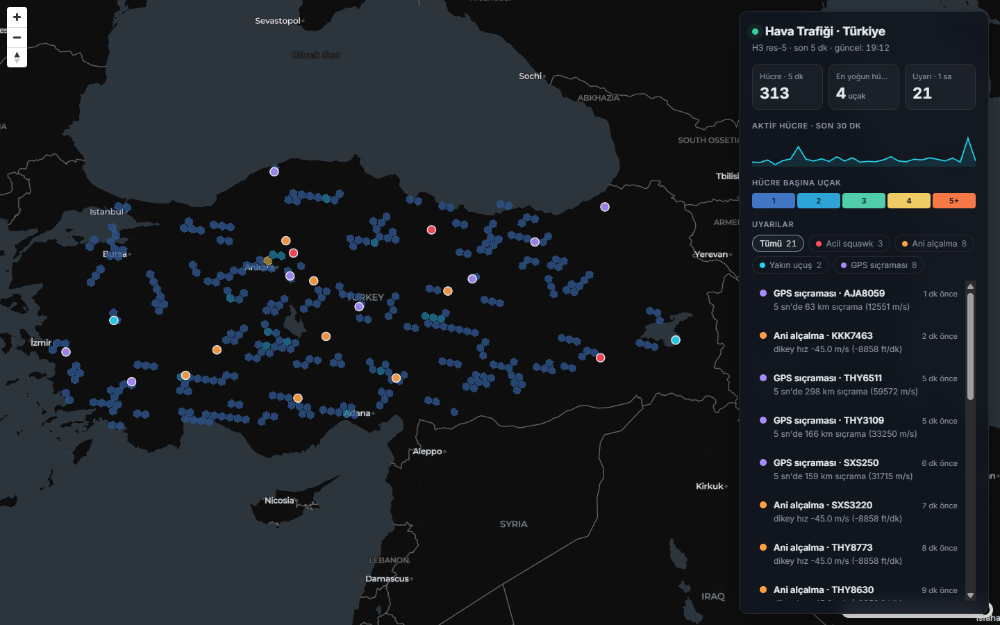
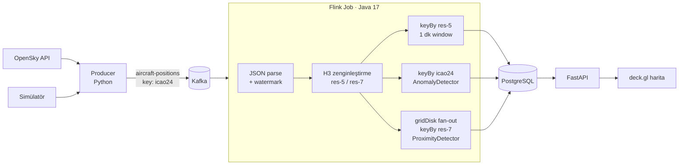

# ✈️ H3 + Apache Flink ile Gerçek Zamanlı Havacılık Telemetrisi

Canlı uçak konum verisini (**OpenSky Network** veya sentetik simülatör) **Kafka** üzerinden akıtan,
**Apache Flink** ile gerçek zamanlı işleyen ve konumları **Uber H3** altıgen hücrelerine indeksleyerek
hava trafiği yoğunluğunu, uçuş anomalilerini ve yakın uçuşları bir harita üzerinde gösteren uçtan uca bir veri akışı projesi.



## Özellikler

- **H3 uzamsal indeksleme**: her konum iki çözünürlükte hücreye atanır: res-5 (~250 km²) bölgesel yoğunluk, res-7 (~5 km²) yakınlık tespiti
- **Event-time işleme**: watermark'lar, 1 dakikalık tumbling window'lar, sıra dışı gelen mesajlara tolerans
- **Durumlu (stateful) tespitler**: uçak bazında keyed state ile ani alçalma, acil squawk kodları ve GPS sıçramaları
- **H3 komşuluğuyla yakın uçuş tespiti**: O(n²) karşılaştırma yerine yalnızca aynı ve komşu hücrelerdeki uçaklar karşılaştırılır
- **Hata toleransı**: exactly-once checkpoint'ler, bozuk mesajlar için side output, PostgreSQL'e idempotent yazım
- **Canlı harita**: deck.gl `H3HexagonLayer` ile hücre izleri, filtrelenebilir uyarı paneli
- **Tek komutla kurulum**: tüm sistem Docker Compose ile ayağa kalkar, lokalde Java veya Maven kurulumu gerekmez

## Mimari



| Katman | Teknoloji |
|---|---|
| Veri kaynağı | OpenSky Network REST API, Python simülatör |
| Mesajlaşma | Apache Kafka 3.9 (KRaft, Zookeeper yok) |
| Akış işleme | Apache Flink 1.20 (DataStream API, Java 17) |
| Uzamsal indeks | Uber H3 4.x (`h3-java`, `h3-js`) |
| Depolama | PostgreSQL 16 |
| API / Görselleştirme | FastAPI, deck.gl 9, MapLibre GL |
| Altyapı / CI | Docker Compose, GitHub Actions |

## Neden H3?

Uçakları bölgelere göre gruplamak veya birbirine yakın olanları bulmak için klasik yöntemler ya pahalıdır
(her uçak çiftinin mesafesini ölçmek: O(n²)) ya da bir uzamsal veritabanı (PostGIS) gerektirir.
H3 dünyayı hiyerarşik altıgenlere böler ve her koordinatı tek bir 64 bitlik hücre kimliğine çevirir:

- **Gruplama, bir `keyBy` işlemine dönüşür.** Hücre kimliği doğrudan Flink'in partition anahtarı olur. Bu yüzden coğrafi toplama, sıradan bir keyed window'dan farksızdır.
- **Komşuluk ucuzdur.** `gridDisk(cell, 1)` bir hücrenin 6 komşusunu sabit sürede verir. Yakın uçuş tespiti bu sayede tüm uçaklar yerine sadece birkaç komşu hücre içinde yapılır.
- **Altıgenlerin tüm komşuları eşit uzaklıktadır.** Kare grid'lerdeki köşe ve kenar komşusu ayrımı yoktur. Bu, mesafe tabanlı analizleri tutarlı kılar.
- **Hiyerarşi yerleşiktir.** Res-7 hücresinin res-5 atası `cellToParent` ile bulunur. Aynı veri, farklı ayrıntı seviyelerinde analiz edilebilir.
- **PostGIS gerekmez.** Hücre kimliği düz bir `VARCHAR` kolonudur ve indekslenebilir.

## Pipeline ayrıntıları

### 1. Kaynak, parse ve watermark
`KafkaSource` ham JSON'u okur. `ParsePositions` mesajı çözüp doğrular; bozuk kayıtlar job'ı düşürmek yerine
`invalid-records` side output'una gider ve `invalidRecords` metriğinde sayılır. Watermark stratejisi 10 saniyelik
sıra dışılığa izin verir. 1 dakika veri gelmeyen bir partisyon `idleness` ile boşta sayılır, böylece pencereler kapanmaya devam eder.

### 2. Hücre trafiği (`cell_traffic`)
`keyBy(h3_res5)` → `TumblingEventTimeWindows(1 dk)` → artımlı `AggregateFunction`. Pencere boyunca kayıtların
kendisi değil, küçük bir ara toplam saklanır. Uçak sayısı farklı `icao24` sayısıdır; ayrıca ortalama irtifa ve hız hesaplanır.

### 3. Uçak bazlı anomaliler (`AnomalyDetector`)
`keyBy(icao24)` ile her uçağın son konumu `ValueState` içinde tutulur. State 30 dakika güncellenmezse TTL ile silinir.

| Uyarı | Kural |
|---|---|
| `RAPID_DESCENT` | Dikey hız < −6000 ft/dk ve irtifa > 1000 m. Her alçalma bölümü için bir kez üretilir. |
| `EMERGENCY_SQUAWK` | 7500 (kaçırma), 7600 (telsiz arızası) veya 7700 (acil durum) koduna geçiş anında üretilir. |
| `SPEED_JUMP` | Önceki konuma göre yer hızı > 450 m/s. Hatalı nokta son konum olarak kaydedilmez. |

### 4. Yakın uçuş (`ProximityDetector`)
1. `ProximityFanOut`, her havadaki konumu kendi res-7 hücresine ve 6 komşusuna kopyalar.
2. `keyBy(targetCell)`: her hücre yalnızca kendi içindeki uçakları ("sakinler") `MapState` içinde saklar.
3. Gelen her kopya sakinlerle karşılaştırılır: yatay ≤ 1 km, dikey ≤ 1000 ft, zaman farkı ≤ 10 sn.
4. Aynı çiftin iki hücrede raporlanmaması için uyarı, iki uçağın ev hücrelerinden alfabetik olarak küçük olanında üretilir.
5. `AlertCooldown`, birlikte uçan çiftlerin her hücre geçişinde tekrar eden uyarılarını 5 dakika boyunca bastırır.

> Eşikler demo amaçlıdır. Gerçek radar ayırma minimumu 5 NM yatay ve 1000 ft dikeydir. Res-7 hücre ile `gridDisk(1)` birlikte, 1 km yatay mesafeyi eksiksiz kapsar.

### 5. Teslim garantisi
Flink 30 saniyede bir exactly-once checkpoint alır. JDBC sink'leri at-least-once çalışır, ama yazımlar idempotenttir:
- `cell_traffic`: `ON CONFLICT (h3_cell, window_start) DO UPDATE`
- `alerts`: `UNIQUE NULLS NOT DISTINCT (alert_type, icao24, other_icao24, event_time)` kısıtı ve `DO NOTHING`

Böylece yeniden başlatmada tekrar işlenen kayıtlar sonuçları değiştirmez.

## Hızlı Başlangıç

Gereksinim: Docker Desktop (Compose v2).

```bash
cp .env.example .env
docker compose up -d --build
```

İlk derleme Maven bağımlılıklarını indirdiği için birkaç dakika sürer. `job-submitter` servisi Flink job'ını
derleyip cluster'a otomatik olarak gönderir. Haritada ilk hücreler yaklaşık 1–2 dakika içinde görünür.

| Servis | Adres |
|---|---|
| Dashboard | http://localhost:8080 |
| Flink Web UI | http://localhost:8081 |
| Kafka (host) | `localhost:9094` |
| PostgreSQL | `localhost:5432` (telemetry / telemetry) |

Job'ı kod değişikliğinden sonra yeniden göndermek için:

```bash
docker compose up -d --build job-submitter
```

`submit.sh` çalışan eski job'ı durdurur ve yenisini gönderir. Kafka offset'leri checkpoint'lerde saklandığı için yeni job kaldığı yerden devam eder.

### Gerçek veriyle çalıştırma (OpenSky)

1. [opensky-network.org](https://opensky-network.org) üzerinde hesap açın ve bir API client oluşturun.
2. `.env` dosyasında `MODE=opensky` yapın; `OPENSKY_CLIENT_ID` ve `OPENSKY_CLIENT_SECRET` değerlerini girin.
3. `docker compose up -d producer`

Türkiye bölgesi istek başına yaklaşık 3 kredi harcar. Bu yüzden kimlikli hesapla ~70 saniyede bir, anonim
erişimle ~11 dakikada bir veri çekilir. Simülatör saniyeler düzeyinde veri ürettiği için demolarda varsayılan mod simülatördür.

### Örnek sorgular

```sql
-- Son pencerenin en yoğun hücreleri
SELECT h3_cell, aircraft_count, round(avg_altitude_m) AS alt_m
FROM cell_traffic
WHERE window_start = (SELECT max(window_start) FROM cell_traffic)
ORDER BY aircraft_count DESC LIMIT 10;

-- Son 1 saatin uyarı dağılımı
SELECT alert_type, count(*) FROM alerts
WHERE event_time > now() - interval '1 hour' GROUP BY 1;
```

## Yapılandırma

| Değişken | Varsayılan | Açıklama |
|---|---|---|
| `MODE` | `sim` | `sim` veya `opensky` |
| `SIM_AIRCRAFT` | `60` | Simülasyondaki uçak sayısı |
| `SIM_TICK_SECONDS` | `5` | Simülatörün mesaj aralığı |
| `BBOX` | `35.8,25.6,42.2,44.8` | OpenSky bölgesi (lamin, lomin, lamax, lomax) |
| `POLL_INTERVAL` | `70` / `660` | OpenSky sorgu aralığı (kimlikli / anonim) |
| `OPENSKY_CLIENT_ID` / `_SECRET` | – | OpenSky OAuth2 kimlik bilgileri |

## Proje yapısı

```
├── producer/          Python: simülatör, OpenSky istemcisi, Kafka producer
├── flink-job/         Maven projesi (Java 17)
│   └── src/main/java/com/aerotelemetry/
│       ├── TelemetryJob.java      pipeline tanımı
│       ├── serde/                 JSON parse + doğrulama
│       ├── h3/                    H3Enricher
│       ├── agg/                   CellAggregator (window toplama)
│       ├── detect/                AnomalyDetector, ProximityFanOut/Detector, AlertCooldown
│       └── sink/                  JDBC sink'leri (upsert)
├── api/               FastAPI (dashboard API'si + statik dosyalar)
├── web/               MapLibre + deck.gl arayüzü
├── db/init.sql        Tablolar ve indeksler
└── docker-compose.yml
```

## Testler

```bash
# Flink job (Docker içinde Maven)
docker run --rm -v "$PWD/flink-job:/src" -w /src maven:3.9-eclipse-temurin-17 mvn -B verify

# Python servisleri
cd producer && pip install -r requirements-dev.txt && pytest
cd api      && pip install -r requirements-dev.txt && pytest
```

- **Flink (26 test):** parser, H3 zenginleştirme, window toplama ve Flink'in `KeyedOneInputStreamOperatorTestHarness`'ı ile gerçek keyed state üzerinde detektör testleri
- **Producer (5 test):** simülatör mesaj şeması, normal uçuşun yanlış alarm üretmemesi, OpenSky yanıtının ayrıştırılması
- **API (8 test):** uçların yanıt biçimi, parametre doğrulama, statik arayüz

GitHub Actions her push'ta tüm testleri çalıştırır ve `docker-compose.yml` dosyasını doğrular.

## Olası geliştirmeler

- Uyarıları ayrı bir Kafka topic'ine de yazıp bildirim servislerine bağlamak
- Uçuş seviyesi bazlı (FL) yakınlık katmanları ve gerçek ayırma minimumlarına göre tespit
- Flink SQL ile ad-hoc analiz sorguları
- Kubernetes üzerinde Flink Operator ile dağıtım, RocksDB state backend ve S3 checkpoint'leri
- Prometheus ve Grafana ile Flink metriklerinin izlenmesi
